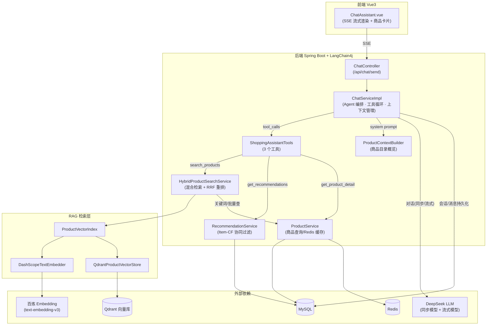
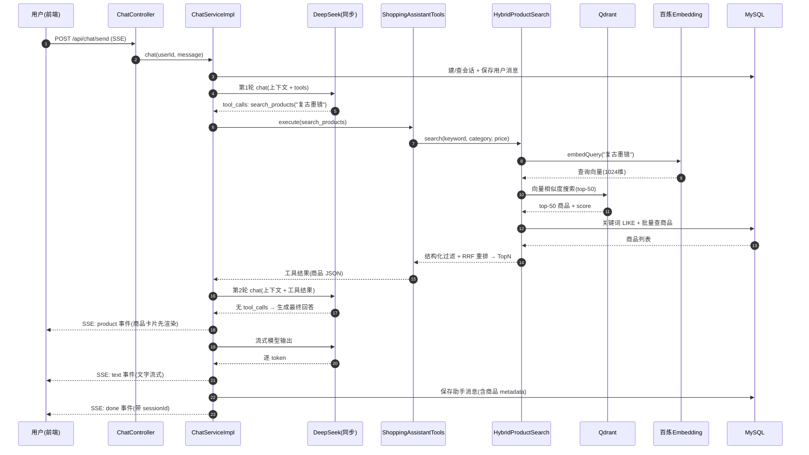

# AI 导购（对话式购物 Agent）架构说明

> 技术栈：Spring Boot + LangChain4j + DeepSeek + 百炼 Embedding + Qdrant + MySQL + Redis
> 本文用 Mermaid 绘制，可在 [Mermaid Live](https://mermaid.live)、GitHub Markdown、Typora、draw.io 中渲染。

## 一、架构图（组件与数据流）



## 二、时序图（一次「帮我找复古墨镜」的完整调用）



## 三、关键设计点

1. **手写工具调用循环**（而非 AiServices）：为了拿到工具返回的商品数据、单独推 `product` SSE 事件。
2. **同步 + 流式双模型**：工具循环用同步模型（需同步拿 tool_calls 结果），最终回答用流式模型（逐 token）。
3. **混合检索**：向量（语义）+ 关键词（字面）+ 结构化过滤 + RRF 重排。
4. **失败降级**：向量检索不可用时自动回退关键词/全库，AI 导购整体不中断。
5. **上下文控制**：商品目录按「分类 Top3」压缩进 system prompt，历史只保留最近 20 条。
6. **工具轮次上限**（3 轮）：防止 LLM 无限调用工具。

## 四、索引构建（启动时）

```
应用启动 → ProductIndexBootstrap
  → 加载全部商品(429件)
  → ProductTextBuilder 拼文本(名称+分类+描述+语义标签)
  → 百炼批量嵌入(1024维)
  → Qdrant 建集合 + upsert
```
